I build open-source tools for apps that AI agents use: a backend where an agent gets a scoped key instead of the database password, the modules that plug into it, the UI kit its admin panel is made of, and an editing layer for the sites on top.

### Now building

 

 

Code: <a href="https://github.com/Kitsuden/kitsuden">Kitsuden/kitsuden</a> ·
<a href="https://github.com/Kitsuden/kitsuden-kons">Kitsuden/kitsuden-kons</a> ·
<a href="https://github.com/tallao-ui/tallao">tallao-ui/tallao</a> ·
<a href="https://github.com/IntiJS/inti">IntiJS/inti</a>

### Activity

### Toolbox

The cards above are SVGs drawn by <a href="scripts/build.mjs">scripts/build.mjs</a>; the activity cards are redrawn every day by a GitHub Action from public contribution data.
