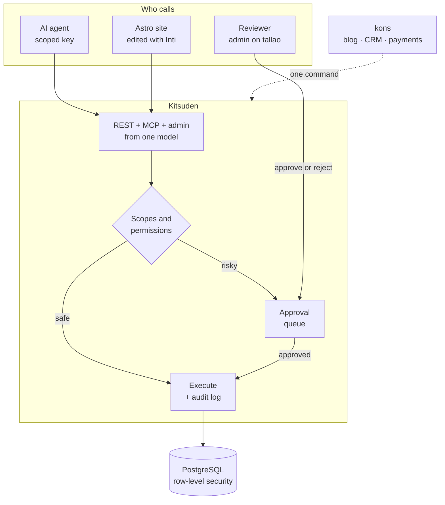

**Data & integration architect, and the author of [Kitsuden](https://github.com/Kitsuden/kitsuden).** Most of my work sits between systems: getting data out of the programs a company already runs, moving it where it is useful, and putting AI on top without rewriting what works. Kitsuden is that experience turned into open source: the backend I wanted for letting AI agents into real systems safely.

### Open source: Kitsuden and its ecosystem

Kitsuden is the project I am proudest of. Around it: **kons** to add features with one command, **tallao** for the interfaces, and **Inti** to edit Astro sites in place.

 

 

Code: <a href="https://github.com/Kitsuden/kitsuden">Kitsuden/kitsuden</a> ·
<a href="https://github.com/Kitsuden/kitsuden-kons">Kitsuden/kitsuden-kons</a> ·
<a href="https://github.com/tallao-ui/tallao">tallao-ui/tallao</a> ·
<a href="https://github.com/IntiJS/inti">IntiJS/inti</a>

### How Kitsuden is designed

- **An agent gets a key, never the database password.** Every key has scopes and every call lands in the audit log.
- **Declare a model once.** REST, MCP tools and the admin panel come from the same declaration, so they cannot drift apart.
- **Risky actions wait for a human.** The agent proposes; a person approves or rejects.
- **The database enforces isolation.** PostgreSQL row-level security, not just checks in application code.
- **The source of truth stays where it is.** Inti saves an edit back to the CMS the content came from.

### What I do at work

- **Data platform:** ELT pipelines into a data warehouse, orchestrated as flows, with APIs over the BI layer.
- **Integrations:** legacy systems, web services and new web apps (CRM, intranet, workflow) talking to each other.
- **AI on existing programs:** agents for data reconciliation and operations, OCR for documents, added to tools people already use.
- **Legacy modernization:** migrating and archiving old finance systems without losing their history.

### Activity

### Toolbox

The cards above are SVGs drawn by <a href="scripts/build.mjs">scripts/build.mjs</a>; the activity cards are redrawn every day by a GitHub Action from public contribution data.
